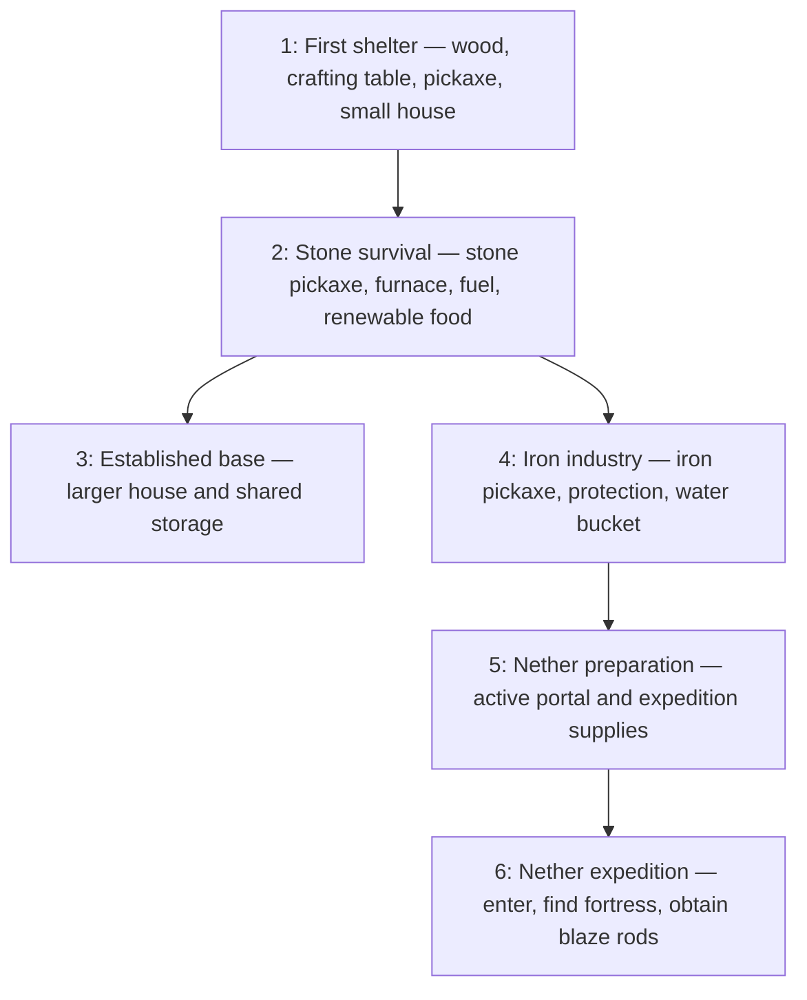

# Agent progression tree

The top-level progression definition lives in `src/bot/progression-tree.ts`.
It describes shared team goals and acceptance criteria, rather than fixed
construction procedures. Example skills are starting points for adaptation;
the agent may invent its own solution.

Every objective within a stage must be verified before that stage completes.
Base expansion and iron industry can run in parallel. Nether progression does
not require the larger house. Examples from prerequisite stages stay available;
movement, mining, crafting, survival, and other basic actions remain foundational.
An empty example list means the library does not yet provide an appropriate
example, as with portal construction and fortress exploration.

`ProgressionState` contains durable verified objective IDs. `evaluateProgression`
computes unlocked stages and retained examples without mutating state.
`recordVerifiedObjective` rejects unknown or locked objectives and records a
milestone idempotently. Its caller must verify the acceptance criteria first;
the function itself does not inspect Minecraft. Milestones track achievements,
so consuming wood or breaking a tool does not erase past progression. Current
readiness and replacement needs must be checked separately before expeditions.

## Live demo

The brain now uses this tree for stage and milestone selection. Verified
milestones are merged across registered bot memory stores and persisted in
each bot's memory file. The dashboard at `http://localhost:3010` displays
stage status and remaining objectives, refreshed every five seconds.

Start the Minecraft server and Ollama, then run `npm run dev` from the project.
For a fresh demo, archive all `memory*.json` files before starting the bots and
create a fresh server world. A new world does not automatically reset agent
memory. Keep the configured settlement anchor and original seed for this demo.

The LLM chooses a stage and milestone; existing bounded procedures execute
the work. Role specialties and team claims reduce duplicate work. A live
observer verifies current carried resources, crafting stations, and the
existing house blueprint, including roof and interior clearance. Furnace and
farm milestones require positive output recorded by the existing skills in
addition to current world observations. Storage requires observed capacity
and successful inventory-changing deposit and retrieval actions.

The existing house example still builds a fixed 9×9 lodge, which satisfies
the starter minimum and can also satisfy the later house size requirement
once lighting and storage are present. Custom house designs and LLM skill
adaptation are not enabled yet. Nether stages are displayed as roadmap goals;
they do not yet have executors or verifiers. Bots wait or handle survival when
no unblocked implemented progression objective is available.

Next, add objective-specific skill generation/adaptation and design-independent
shelter verification. Generated skill completion alone must never advance the tree.
